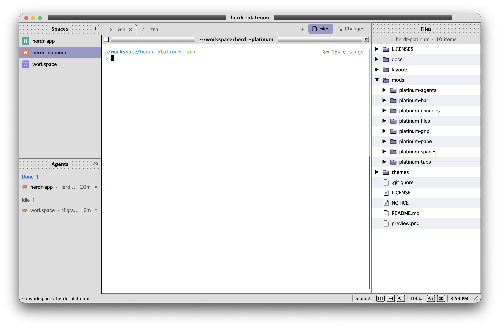

# Mac OS 9 Platinum Retro

Herdr dressed as Mac OS 9 Platinum: flat light-grey chrome, a periwinkle
selection, square corners, black 1px outlines, Lucida Grande bold titles
over embossed pinstripes, and a bevelled status bar along the bottom with a
resize grip. Nine mods make the pieces. They need a layout with matching
block slots (see Built from).

## What you see

Palette (theme tokens the mods read through `theme()`): chrome and surface
`#dddddd`, canvas `#b8b8c4`, selected and accent `#9999cc`, hover `#cccccc`,
border `#777777`, dim and muted `#555555`, input `#ffffff`, foreground
`#000000`, working `#cc9900`, blocked `#cc0000`, done `#3366cc`. Terminal
background white. Text is 14px or larger, except the status bar and the
Spaces and Agents rows (13px).
UI font Geneva, titles Lucida Grande bold, terminal Monaco 14.

Top to bottom:

- **Window bar**, 28px, `chrome`, raised bevel (white 2px top and left, grey
  2px bottom, grey 1px right), 1px `border` underneath. Left gap of
  78px (divided by UI zoom) clears the macOS window buttons. Then five
  embossed stripes, the active space's name centred (bold, max 320px,
  truncated), five more stripes, and a right gap 8px shorter than the left.
  A stripe is a 1px `dim` line over a 1px white line, 1px apart, 4px side
  padding.
- **Left column**, 240px: Spaces over Agents. Each has a 14px header on a
  dotted, embossed title bar (an SVG of dots) with a 1px `border` line under
  it. The action button at the right of each header (the `+` in Spaces, the
  sort button in Agents) is a 20x16 Platinum push button with the same bevel
  as the tab bar buttons. Rows follow the Mac OS 9 Application menu: bold 13px Lucida Grande, 28px high (26px for worktree
  rows), a `✓` in a 12px slot before the icon on the active space or focused
  agent, and the `selected` highlight only under the pointer.
- **Tab bar**, 40px, `chrome`. Tabs 32px tall with slanted sides and rounded
  tops, as in Mac OS 9 tab panels, bold Lucida Grande text, no gap between
  tabs. The active tab is `surface` with a black outline on top and the
  slants, open at the bottom so it joins the pane below. Inactive tabs are
  `#bbbbbb` with the same outline. Right after the last tab, a small
  inactive tab holds a bold `+` (same caps and face, inside the scrolling
  row). Then come Files and Changes panel buttons (24px high). These are Platinum push buttons, bold 14px text, black 1px outline,
  radius 3, white highlight top and left, `#808080` shadow bottom and right
  (same bevel as the status bar buttons). The open panel's button is
  depressed: the bevel is swapped and the face is darker grey `#bbbbbb`.
  With `cria-file-preview` installed, a `> Preview` button sits between `+`
  and Files. It opens the `platinum-open` dialog (a text box, Cancel, Open
  Tab, Open Split): paste a path, newlines removed, and the file opens in a
  split pane to the right (the default button, and Return), or a preview tab. With the `agenttrail` mod
  installed (sodiumsun/agenttrail, set its `mod.json` `place` to `none` or it
  docks itself into the layout), a compass `Map` button follows Preview and
  runs `pane.split` `{direction:"right", mod:"agenttrail"}`. An optional panel
  button,
  Extended, shows only when the `cria-files-extended` mod is installed and the
  layout has a `files-extended` block. Buttons, tab, space and agent names, and
  the status bar items carry `.tooltip(text)` labels: names in full (a space adds its grey repo and branch text), buttons
  a few words (the grip says "Resize window"; the pane close and zoom boxes
  say "Close pane" and "Zoom pane").
- **Pane**, white, 1px black border, no radius. Header 26px with a raised
  bevel (white 2px top and left, grey `#808080` 2px bottom and 1px right): a
  14px close box at the left (1px black outline, sunken 1px bevel, face
  darkening downwards in five bands of black at rising alpha, empty),
  pinstripes, the title centred in bold, pinstripes, a 14px zoom box at the
  right (same box with a 6px inner square). Only the focused pane has stripes and boxes. An
  unfocused pane has a plain `surface` title in `muted`.
- **Panel bevels**, 2px. The Spaces and Agents title strips are raised (1px
  grey on the right) and their lists are sunken (grey `#808080` top and
  left, white bottom and right), with the list on `chrome`, via `raised` and `sunken` helpers. The right panel (Files, Changes)
  sits in a sunken `frame`.
- **Right panel**, 320px, hidden until opened: Files or Changes, same dotted
  title bar. Files uses full-colour folder (closed and open) and page icons,
  square corners, lilac row hover. Changes has a grey header, square
  corners, black borders, a square commit input and a rectangular bordered
  Commit button.
- **Status bar**, 26px, full window width under everything, `chrome`, 1px
  `border` above, 13px Lucida Grande, 8px side padding, 6px gaps. Left to
  right: breadcrumbs of the focused pane's folder (fills the row), the git
  branch in a sunken field, two split buttons, `A−`, a zoom percent field,
  `A+`, `⌘`, the clock in a sunken field, the resize grip.

## How it behaves

- Agent status shows on tabs and in the agents list: working is a spinner
  (tab) in `working`, blocked and done are an 8px dot in `blocked` or
  `done`, idle is a plain hollow marker. This is Herdr's own behaviour,
  kept unchanged in the copies.
- Click a pane header to focus it, or move the pointer onto it: the header
  is the only part of a pane a mod can hook, so focus follows hover there
  only. The close box closes the pane. The zoom box zooms the pane.
- Tabs: click selects, double click renames, right click opens the tab
  menu, drag onto another tab moves it, the wheel or a touchpad swipe
  switches tabs. `+` opens the new-tab menu. The panel button toggles that
  panel. The open panel is remembered per space.
- Hover: buttons go to `hover` grey, pane boxes to `accent`.
- Menus and dialogs follow Mac OS 9. A menu is a `#dddddd` face with a black
  1px outline, a white 1px highlight inside on the top and left, `#808080`
  on the bottom and right, and a 2px drop shadow (`#00000066`, offset down
  and right). Rows are 22px, bold 14px Lucida Grande, with a solid `#3366aa`
  highlight and white text under the pointer. A separator is a grey line
  over a white line. Disabled rows are `#808080`. Shortcuts sit on the right
  as glyphs (`⇧⌘D`), each modifier in a 14px cell so they line up. A dialog
  is the same grey with a 3px shadow, bevelled push buttons (the default one
  double outlined), and a text box with a black outline, a grey inner edge
  on the top and left, and a `#6a9fd0` ring while focused. Menus and dialogs
  open with `frame: "none"` so Herdr draws no border or corners of its own,
  and the popup is a few px larger than the menu to hold the shadow.
- Status bar breadcrumbs: `~` for the home folder, then at most the last four
  folders joined with ` › `, prefixed with `… › ` when longer. Updates with
  focus.
- Branch field: appears only inside a git repository, as `main ✓` (clean) or
  `main ✗` (changes). Git is asked when the folder or machine changes and
  every 20 seconds.
- Status bar buttons: split right (`pane.split` `{direction:"right"}`),
  split down (`{direction:"down"}`), `A−` (`app.zoom_out`), `A+`
  (`app.zoom_in`), `⌘` (`app.palette`). The zoom field shows
  `settings().zoom` as a percent. The clock reads `h:mm AM/PM` and redraws
  every 2 seconds.
- Resize grip: shows a diagonal-resize cursor. A click runs
  `window.maximize`, toggling the window zoom. It does not drag.
- `cmd-k` opens the command palette (`keys.json`).

## Built from

Every mod folder holds `main.js` and `mod.json` (`{ "place": "none" }`), plus
SVGs where named. All use `gpui-kit` (`View`, `div`, `svg`, `image`) and
`gpui-base` (`h_flex`, `v_flex`). Image and SVG paths are relative to the
Herdr home: `mods/<name>/<file>`.

Layout the mods expect (the person's own layout must provide it): a root
column with `titlebar: "none"`, `traffic_lights: [14, 7]`, `font: "Monaco"`,
`font_size: 14`, `ui_font: "Geneva"`. Children, in order:

1. block `titlebar`, 28px, `window_drag`, mod `platinum-bar`.
2. row `body`, 1px `border` dividers, holding column `sidebar` (240px, min
   40, max 480, `surface`; blocks `spaces` = `platinum-spaces` and `agents` =
   `platinum-agents`), column `work` (`canvas`; block `tabs` 40px =
   `platinum-tabs`, then block `main` showing the active tab with pane
   options gap 8, radius 0, background `surface`, border and focus 1px
   `#000000`, `lone: true`, header mod `platinum-pane`, 26px, top, reveal
   always), and column `panel` (320px, min 200, max 640, hidden, a stack
   `panel-body` with active `files`, children blocks `files` =
   `platinum-files` and `changes` = `platinum-changes`). The tabs mod looks
   up the ids `sidebar`, `panel` and `panel-body`.
3. block `footer`, 26px, mod `platinum-grip`, as the last child of the root
   so it spans the full width.

Mods:

- `platinum-bar`: reads `spaces()`, `theme()`, `settings()`. Shows the active
  space name between stripes.
- `platinum-pane`: pane header. Props `{pane, terminal}`. Calls `pane.close`,
  `pane.zoom`, `pane.focus`. Strips a leading `user@host:` from titles.
- `platinum-tabs`, `platinum-spaces`, `platinum-agents`, `platinum-files`,
  `platinum-changes`: modified copies of Herdr's shipped `tabs`, `spaces`,
  `agents`, `files` and `changes` mods, restyled only (grey tokens, square
  corners, 14px text, taller rows). Start from Herdr's copy, keep behaviour,
  change the look as in What you see. Apache 2.0, see `LICENSE` and `NOTICE`. They call
  `exec` for git and read files, and the tabs mod draws Herdr's own
  `mods/workspace-chrome/spinner.svg` and `mods/pane/close.svg`.
  Art: `titlebar-dots.svg`, `dots-emboss.svg`, `dots-emboss-tall.svg`
  (dotted title bars), `folder-closed.svg`, `folder-open.svg`, `file.svg`,
  and `tab-left-fill.svg`, `tab-left-line.svg`, `tab-right-fill.svg`,
  `tab-right-line.svg` (14x32 tab caps). SVGs are one-colour masks tinted by
  `text_color`, so each cap is a fill layer and an outline layer.
- `platinum-grip`: the status bar. `herdr` functions: `exec`, `focused`,
  `panes`, `run`, `settings`, `spaces`, `theme`. Runs
  `git --no-optional-locks status --porcelain=v1 -b -uno` in the focused
  folder, on the pane's machine when it is remote. `cx.timer.every(2000)` for
  the clock. Art: `split-right.svg`, `split-down.svg` (14x14, white box, 1px
  black outline, a vertical or horizontal divider) and `grip-2.svg` (14x14,
  three diagonal `#555555` lines with a white copy shifted 1px right,
  `crispEdges`). Sunken field: outer div `pr(1).pb(1)` white, inner
  `pt(1).pl(1)` `#808080`, face `surface`, 18px high. Raised button: 20x16,
  black 1px outline, radius 3, outer `pr(1).pb(1)` `#808080`, inner
  `pt(1).pl(1)` white, face `chrome`, bold 13px.

Optional mods (gsydler/herdr-cria). Each is detected by a folder check in
`${HERDR_APP_HOME:-$HOME/.config/herdr-app}/mods`; without it, nothing changes.

- `cria-file-preview`: a click on a file in `platinum-files` opens it in a
  preview tab (`tab.new` with `mod` and `props` `{file, on}`).
- `platinum-open` (in this repo, needs `cria-file-preview`): the open-by-path
  dialog. Same folder layout as the other mods; no layout block needed.
- `platinum-menu`: modified copy of Herdr's `menu` mod, the right-click menu
  for spaces, tabs and terminals. Opened by `platinum-spaces` and
  `platinum-tabs`, and by the layout root's `"terminal_menu":
  "platinum-menu"`; its `mod.json` sets the popup size and `frame: "none"`.
- `platinum-new-menu`: the `+` menu, written to replace Herdr's `new-menu`,
  which a layout can't swap. Uses `knownAgents()` (installed ones only),
  `tab.new`, `space.new`. Opened by `platinum-tabs`.
- `platinum-worktree`: modified copy of Herdr's `worktree` mod (New, Open and
  Remove worktree dialogs). Opened by `platinum-new-menu` and
  `platinum-menu`.
- `cria-files-extended`: a Files panel with a right-click menu and file icons.
  Add `{ "id": "files-extended", "type": "block", "content": { "mod":
  "cria-files-extended" } }` to the `panel-body` stack (see
  `layouts/platinum.json`) and `platinum-tabs` shows its button.

`keys.json` merges into the person's own: add `cmd-k` under `global` and ask
before replacing a key they use.

## Watch out

- Elements have no per-edge border colours. Bevels are nested divs with
  padding. Do not try `border_color` per side.
- Image cache is keyed by path. A changed SVG must get a new file name
  (`grip.svg` became `grip-2.svg`), or the old one shows.
- The macOS window corner is rounded and clips the bottom-right. Keep the
  grip inset (`pr(8)` on the status bar).
- Mods linked with `ln -s` do not reload on edit: run `layout.switch` to
  another layout and back. Re-running `ln -s` on an existing folder link
  makes a self-link inside it.
- The window buttons sit over the bar's left gap. `BUTTONS_GAP` (78) in
  `platinum-bar` must follow the layout's `traffic_lights`.
- There is no command to resize the window and no drag events, so the grip
  cannot drag. A terminal cols×rows readout is left out for the same
  reason: no such field exists.
- The copied mods do not follow Herdr updates.
- Programs that assume a dark terminal may be hard to read on white.
- Assumes macOS, the Geneva, Lucida Grande and Monaco fonts, and `git` on the
  path.

## Done when

- `herdr-app check mods/<name>` passes for all twelve mods.
- After switching to a layout that hosts them, the window bar shows the
  space name between five stripes each side and the macOS buttons are clear
  of it.
- The focused pane header shows a close box, stripes, a bold centred title
  and a zoom box. A second, unfocused pane shows a plain grey title and no
  boxes.
- The active tab is `surface` with a black outline open at the bottom.
- In a git repository the status bar shows `branch ✓` or `branch ✗`; in a
  plain folder it shows no branch field.
- Split right and split down add a pane. `A+` and `A−` change the zoom
  percent shown. `⌘` and `cmd-k` open the palette.
- The clock matches the system time within a minute.
- The grip sits inside the bottom-right corner, fully visible, and a click
  maximizes or restores the window.
- The Files panel shows folder and page icons in colour. The Commit button
  in Changes is a bordered rectangle.
- With `cria-file-preview` installed, the `> Preview` button opens a dialog.
  A pasted path, even with a stray newline, opens in a preview tab (Open) or
  a split pane (Open Split). Without that mod, the button is absent.
